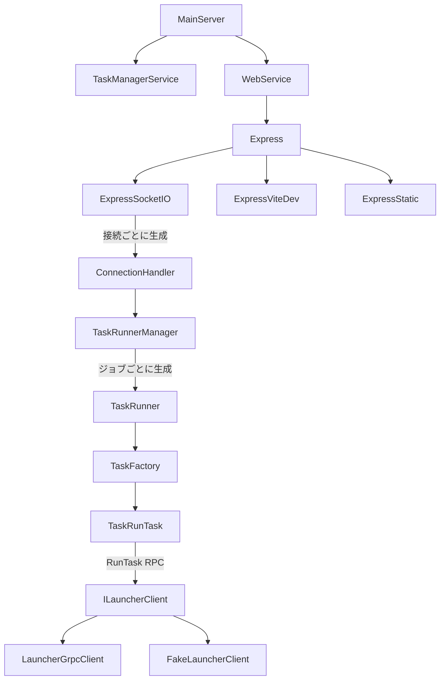

# src/app/ — サーバサイドアーキテクチャ

## 概要

クライアントからコード実行リクエストを受け取り、隔離された Launcher 環境で実行し、結果をリアルタイムに返却するサーバサイドアプリケーション。

## クラス関係図



## データフロー

```
Client                    Server                           Launcher(Go)
  │                         │                                │
  │── c2e_Exec (init) ─────▶│                                │
  │   {clicmid, lang,       │                                │
  │    code, stdin}          │                                │
  │                         │── RunTask (gRPC stream) ──────▶│
  │                         │◀─ started {task_id} ──────────│
  │                         │◀─ phase_result (stdout等) ────│
  │                         │◀─ completed ──────────────────│
  │                         │                                │
  │◀─ s2c_ResultExec ──────│                                │
  │   {clicmid, report,     │                                │
  │    continue: false}      │                                │
```

## 主要モジュール

| モジュール | 責務 |
|-----------|------|
| [main-server.ts](main-server.ts) | 構成ルート。Launcher→TaskManager→Web の順に組み立て、SIGINT で停止 |
| [task-manager-service.ts](task-manager-service.ts) | Socket接続単位の ConnectionHandler 実装。runSingleTask/kill を TaskRunner に振り分け |
| [web/web-service.ts](web/web-service.ts) | HTTP/HTTPS サーバ起動ラッパ。SSL設定と Express セットアップ委譲 |
| [config.ts](config.ts) | 環境変数から実行モード・ポート・フロント種別等を集約 |
| [connection-handler.ts](connection-handler.ts) | ConnectionHandler / ConnectionHandlerFactory のインターフェース定義 |

## サブディレクトリ

### launcher/ — 外部プロセス通信層

Launcher（`deps/applauncher-go`）との gRPC 通信を抽象化する。

| ファイル | 責務 |
|---------|------|
| [launcher-client-interface.ts](launcher/launcher-client-interface.ts) | ILauncherClient インターフェース定義 |
| [launcher-grpc-client.ts](launcher/launcher-grpc-client.ts) | gRPC による ILauncherClient 実装 |
| [child-process-grpc-launcher.ts](launcher/child-process-grpc-launcher.ts) | Go Launcher を子プロセスとして起動・管理 |
| [fake-launcher-client.ts](launcher/fake-launcher-client.ts) | テスト用 ILauncherClient Fake 実装 |

### task/ — タスク実装

| ファイル | 責務 |
|---------|------|
| [task-interface.ts](task/task-interface.ts) | タスク共通インターフェース |
| [task-factory.ts](task/task-factory.ts) | lang に応じた Task 生成 (Factory Pattern) |
| [task-util.ts](task/task-util.ts) | タスク共通ユーティリティ型定義 |
| [task-run-task.ts](task/task-run-task.ts) | RunTask RPC 統一実装（言語ロジックをサーバ側に委譲） |
| [lang/annotation-parsers.ts](task/lang/annotation-parsers.ts) | 言語別 stderr→Annotation パーサー |

### task-runner/ — ジョブ管理

| ファイル | 責務 |
|---------|------|
| [task-runner.ts](task-runner/task-runner.ts) | 1ジョブ実行単位。Task 生成・開始・kill 委譲 |
| [task-runner-manager.ts](task-runner/task-runner-manager.ts) | 接続内ジョブマップ管理 (register/unregister/cleanup) |

### web/ — HTTP/Socket.IO 層

| ファイル | 責務 |
|---------|------|
| [express.ts](web/express.ts) | フロントエンドバインドと HTTP/HTTPS + Socket.IO 起動 |
| [express-socket-io.ts](web/express-socket-io.ts) | Socket.IO イベントと ConnectionHandler の橋渡し |
| [express-vite-dev.ts](web/express-vite-dev.ts) | 開発時 Vite middleware 組み込み |
| [express-static.ts](web/express-static.ts) | 本番静的配信 (dist/) |
| [web-service.ts](web/web-service.ts) | HTTP/HTTPS サーバ起動ラッパ。SSL設定と Express セットアップ委譲 |

## 設計パターン

- **Dependency Injection**: MainServer が ILauncherClient を生成し下位へ注入
- **Factory Pattern**: TaskFactory (言語別)
- **Template Method Pattern**: BaseFileStdinTask が setup→store→phases→finalize の骨組みを提供し、言語タスクがフェーズを実装
- **Strategy Pattern**: ILauncherClient インターフェースで通信層を抽象化（gRPC実装/Fake実装を差し替え可能）
- **Manager Pattern**: TaskRunnerManager が接続単位で TaskRunner を管理
- **Phase Pipeline**: TaskUtil の段階実行 (setup→store→exec→pull→finalize)

## Socket.IO イベント

| イベント名 | 方向 | 用途 |
|-----------|------|------|
| `connection` | — | 新規接続時に ConnectionHandler 生成 |
| `disconnect` | — | 切断時に TaskRunnerManager.cleanup |
| `runSingleTask` | Client→Server | タスク実行リクエスト |
| `kill` | Client→Server | 実行中タスクの中断リクエスト |
| `taskResult` | Server→Client | 逐次結果・最終結果返却 |

## 相関ID体系

- **ClientJobID (`clicmid`)**: クライアントが発行。リクエスト〜レスポンスの対応付けに使用
- **LauncherQueryID (`request_id`)**: サーバが発行。Launcher への個別コマンドと応答の対応付けに使用

## 注意点

- バリデーション関数（`validateRunSingleTask`, `validateKill`）は基本的なフィールド存在チェックのみ実装済み。本格的なバリデーションは別タスク
- WebService.stop / TaskManagerService.stop は実質 no-op
- サーバに用いる環境変数や設定は必ず config.ts に集約。直接 process.env を参照しない。
